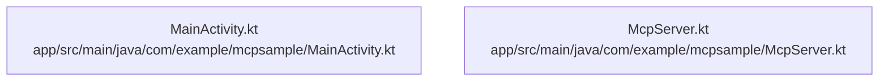

# dependency-map

[解析トップへ戻る](../README.md)

内容確認したソースの静的依存関係。PythonはAST、JavaScript／TypeScriptはimport文の字句抽出です。型だけのimport、再export、コメントや動的importの扱いには制限があり、ランタイム依存の完全なグラフではありません。

## 要素の説明

### n-app-src-main-java-com-example-mcpsample-mainactivity-kt-8500b4

確認済みファイル: `app/src/main/java/com/example/mcpsample/MainActivity.kt`

解析: 字句抽出。静的なimport／export参照です。関数の実行順序やHTTP通信は表していません。

宣言: `MainActivity`, `MainViewModel`

- `android.os.Bundle` → 外部・標準ライブラリ・別名など。ローカル対応先は未確定
- `androidx.activity.ComponentActivity` → 外部・標準ライブラリ・別名など。ローカル対応先は未確定
- `androidx.activity.compose.setContent` → 外部・標準ライブラリ・別名など。ローカル対応先は未確定
- `androidx.compose.foundation.background` → 外部・標準ライブラリ・別名など。ローカル対応先は未確定
- `androidx.compose.foundation.border` → 外部・標準ライブラリ・別名など。ローカル対応先は未確定
- `androidx.compose.foundation.layout.` → 外部・標準ライブラリ・別名など。ローカル対応先は未確定
- `androidx.compose.foundation.lazy.LazyColumn` → 外部・標準ライブラリ・別名など。ローカル対応先は未確定
- `androidx.compose.foundation.lazy.items` → 外部・標準ライブラリ・別名など。ローカル対応先は未確定
- `androidx.compose.foundation.lazy.rememberLazyListState` → 外部・標準ライブラリ・別名など。ローカル対応先は未確定
- `androidx.compose.foundation.shape.RoundedCornerShape` → 外部・標準ライブラリ・別名など。ローカル対応先は未確定
- `androidx.compose.material3.` → 外部・標準ライブラリ・別名など。ローカル対応先は未確定
- `androidx.compose.runtime.` → 外部・標準ライブラリ・別名など。ローカル対応先は未確定
- `androidx.compose.ui.Alignment` → 外部・標準ライブラリ・別名など。ローカル対応先は未確定
- `androidx.compose.ui.Modifier` → 外部・標準ライブラリ・別名など。ローカル対応先は未確定
- `androidx.compose.ui.graphics.Color` → 外部・標準ライブラリ・別名など。ローカル対応先は未確定
- `androidx.compose.ui.text.font.FontFamily` → 外部・標準ライブラリ・別名など。ローカル対応先は未確定
- `androidx.compose.ui.text.font.FontWeight` → 外部・標準ライブラリ・別名など。ローカル対応先は未確定
- `androidx.compose.ui.unit.dp` → 外部・標準ライブラリ・別名など。ローカル対応先は未確定
- `androidx.compose.ui.unit.sp` → 外部・標準ライブラリ・別名など。ローカル対応先は未確定
- `androidx.lifecycle.ViewModel` → 外部・標準ライブラリ・別名など。ローカル対応先は未確定
- `androidx.lifecycle.viewModelScope` → 外部・標準ライブラリ・別名など。ローカル対応先は未確定
- `androidx.lifecycle.viewmodel.compose.viewModel` → 外部・標準ライブラリ・別名など。ローカル対応先は未確定
- `kotlinx.coroutines.flow.MutableStateFlow` → 外部・標準ライブラリ・別名など。ローカル対応先は未確定
- `kotlinx.coroutines.flow.StateFlow` → 外部・標準ライブラリ・別名など。ローカル対応先は未確定
- `kotlinx.coroutines.flow.asStateFlow` → 外部・標準ライブラリ・別名など。ローカル対応先は未確定
- `kotlinx.coroutines.launch` → 外部・標準ライブラリ・別名など。ローカル対応先は未確定

[詳細な図と説明を見る](n-app-src-main-java-com-example-mcpsample-mainactivity-kt-8500b4/README.md)

### n-app-src-main-java-com-example-mcpsample-mcpserver-kt-b8760f

確認済みファイル: `app/src/main/java/com/example/mcpsample/McpServer.kt`

解析: 字句抽出。静的なimport／export参照です。関数の実行順序やHTTP通信は表していません。

宣言: `McpServer`

- `android.util.Log` → 外部・標準ライブラリ・別名など。ローカル対応先は未確定
- `kotlinx.coroutines.` → 外部・標準ライブラリ・別名など。ローカル対応先は未確定
- `kotlinx.serialization.json.` → 外部・標準ライブラリ・別名など。ローカル対応先は未確定
- `java.util.concurrent.ConcurrentHashMap` → 外部・標準ライブラリ・別名など。ローカル対応先は未確定

[詳細な図と説明を見る](n-app-src-main-java-com-example-mcpsample-mcpserver-kt-b8760f/README.md)

