# dependency-map/n-app-src-main-java-com-example-mcpsample-mainactivity-kt-8500b4/imports-1

[解析トップへ戻る](../../../README.md)

import参照の表示用グループ。

```mermaid
graph TD
    source["ソース\napp/src/main/java/com/example/mcpsample/MainActivity.kt"]
    n-android-os-bundle-65616f["android.os.Bundle\n外部・別名・未解決"]
    source -->|"字句抽出: import／export"| n-android-os-bundle-65616f
    n-androidx-activity-componentactivity-52c165["androidx.activity.ComponentActivity\n外部・別名・未解決"]
    source -->|"字句抽出: import／export"| n-androidx-activity-componentactivity-52c165
    n-androidx-activity-compose-setcontent-8ee236["androidx.activity.compose.setContent\n外部・別名・未解決"]
    source -->|"字句抽出: import／export"| n-androidx-activity-compose-setcontent-8ee236
    n-androidx-compose-foundation-background-dbe0cc["androidx.compose.foundation.background\n外部・別名・未解決"]
    source -->|"字句抽出: import／export"| n-androidx-compose-foundation-background-dbe0cc
    n-androidx-compose-foundation-border-38a194["androidx.compose.foundation.border\n外部・別名・未解決"]
    source -->|"字句抽出: import／export"| n-androidx-compose-foundation-border-38a194
    n-androidx-compose-foundation-layout-c57631["androidx.compose.foundation.layout.\n外部・別名・未解決"]
    source -->|"字句抽出: import／export"| n-androidx-compose-foundation-layout-c57631
    n-androidx-compose-foundation-lazy-lazycolumn-6fed52["androidx.compose.foundation.lazy.LazyColumn\n外部・別名・未解決"]
    source -->|"字句抽出: import／export"| n-androidx-compose-foundation-lazy-lazycolumn-6fed52
    n-androidx-compose-foundation-lazy-items-86d96b["androidx.compose.foundation.lazy.items\n外部・別名・未解決"]
    source -->|"字句抽出: import／export"| n-androidx-compose-foundation-lazy-items-86d96b
```

## 要素の説明

### n-android-os-bundle-65616f

参照名: `android.os.Bundle`

ローカルのソース対応先を確定できませんでした。外部ライブラリ、標準ライブラリ、型別名などを区別する追加確認が必要です。

### n-androidx-activity-componentactivity-52c165

参照名: `androidx.activity.ComponentActivity`

ローカルのソース対応先を確定できませんでした。外部ライブラリ、標準ライブラリ、型別名などを区別する追加確認が必要です。

### n-androidx-activity-compose-setcontent-8ee236

参照名: `androidx.activity.compose.setContent`

ローカルのソース対応先を確定できませんでした。外部ライブラリ、標準ライブラリ、型別名などを区別する追加確認が必要です。

### n-androidx-compose-foundation-background-dbe0cc

参照名: `androidx.compose.foundation.background`

ローカルのソース対応先を確定できませんでした。外部ライブラリ、標準ライブラリ、型別名などを区別する追加確認が必要です。

### n-androidx-compose-foundation-border-38a194

参照名: `androidx.compose.foundation.border`

ローカルのソース対応先を確定できませんでした。外部ライブラリ、標準ライブラリ、型別名などを区別する追加確認が必要です。

### n-androidx-compose-foundation-layout-c57631

参照名: `androidx.compose.foundation.layout.`

ローカルのソース対応先を確定できませんでした。外部ライブラリ、標準ライブラリ、型別名などを区別する追加確認が必要です。

### n-androidx-compose-foundation-lazy-items-86d96b

参照名: `androidx.compose.foundation.lazy.items`

ローカルのソース対応先を確定できませんでした。外部ライブラリ、標準ライブラリ、型別名などを区別する追加確認が必要です。

### n-androidx-compose-foundation-lazy-lazycolumn-6fed52

参照名: `androidx.compose.foundation.lazy.LazyColumn`

ローカルのソース対応先を確定できませんでした。外部ライブラリ、標準ライブラリ、型別名などを区別する追加確認が必要です。

### source

`app/src/main/java/com/example/mcpsample/MainActivity.kt` の内容を確認しました。

