# dependency-map/n-app-src-main-java-com-example-mcpsample-mainactivity-kt-8500b4/imports-2

[解析トップへ戻る](../../../README.md)

import参照の表示用グループ。

```mermaid
graph TD
    source["ソース\napp/src/main/java/com/example/mcpsample/MainActivity.kt"]
    n-androidx-compose-foundation-lazy-rememberlazyliststate-bea1a1["androidx.compose.foundation.lazy.rememberLazyListState\n外部・別名・未解決"]
    source -->|"字句抽出: import／export"| n-androidx-compose-foundation-lazy-rememberlazyliststate-bea1a1
    n-androidx-compose-foundation-shape-roundedcornershape-674912["androidx.compose.foundation.shape.RoundedCornerShape\n外部・別名・未解決"]
    source -->|"字句抽出: import／export"| n-androidx-compose-foundation-shape-roundedcornershape-674912
    n-androidx-compose-material3-b7ff21["androidx.compose.material3.\n外部・別名・未解決"]
    source -->|"字句抽出: import／export"| n-androidx-compose-material3-b7ff21
    n-androidx-compose-runtime-6d5413["androidx.compose.runtime.\n外部・別名・未解決"]
    source -->|"字句抽出: import／export"| n-androidx-compose-runtime-6d5413
    n-androidx-compose-ui-alignment-7c1246["androidx.compose.ui.Alignment\n外部・別名・未解決"]
    source -->|"字句抽出: import／export"| n-androidx-compose-ui-alignment-7c1246
    n-androidx-compose-ui-modifier-beca5f["androidx.compose.ui.Modifier\n外部・別名・未解決"]
    source -->|"字句抽出: import／export"| n-androidx-compose-ui-modifier-beca5f
    n-androidx-compose-ui-graphics-color-34c17a["androidx.compose.ui.graphics.Color\n外部・別名・未解決"]
    source -->|"字句抽出: import／export"| n-androidx-compose-ui-graphics-color-34c17a
    n-androidx-compose-ui-text-font-fontfamily-780f57["androidx.compose.ui.text.font.FontFamily\n外部・別名・未解決"]
    source -->|"字句抽出: import／export"| n-androidx-compose-ui-text-font-fontfamily-780f57
```

## 要素の説明

### n-androidx-compose-foundation-lazy-rememberlazyliststate-bea1a1

参照名: `androidx.compose.foundation.lazy.rememberLazyListState`

ローカルのソース対応先を確定できませんでした。外部ライブラリ、標準ライブラリ、型別名などを区別する追加確認が必要です。

### n-androidx-compose-foundation-shape-roundedcornershape-674912

参照名: `androidx.compose.foundation.shape.RoundedCornerShape`

ローカルのソース対応先を確定できませんでした。外部ライブラリ、標準ライブラリ、型別名などを区別する追加確認が必要です。

### n-androidx-compose-material3-b7ff21

参照名: `androidx.compose.material3.`

ローカルのソース対応先を確定できませんでした。外部ライブラリ、標準ライブラリ、型別名などを区別する追加確認が必要です。

### n-androidx-compose-runtime-6d5413

参照名: `androidx.compose.runtime.`

ローカルのソース対応先を確定できませんでした。外部ライブラリ、標準ライブラリ、型別名などを区別する追加確認が必要です。

### n-androidx-compose-ui-alignment-7c1246

参照名: `androidx.compose.ui.Alignment`

ローカルのソース対応先を確定できませんでした。外部ライブラリ、標準ライブラリ、型別名などを区別する追加確認が必要です。

### n-androidx-compose-ui-graphics-color-34c17a

参照名: `androidx.compose.ui.graphics.Color`

ローカルのソース対応先を確定できませんでした。外部ライブラリ、標準ライブラリ、型別名などを区別する追加確認が必要です。

### n-androidx-compose-ui-modifier-beca5f

参照名: `androidx.compose.ui.Modifier`

ローカルのソース対応先を確定できませんでした。外部ライブラリ、標準ライブラリ、型別名などを区別する追加確認が必要です。

### n-androidx-compose-ui-text-font-fontfamily-780f57

参照名: `androidx.compose.ui.text.font.FontFamily`

ローカルのソース対応先を確定できませんでした。外部ライブラリ、標準ライブラリ、型別名などを区別する追加確認が必要です。

### source

`app/src/main/java/com/example/mcpsample/MainActivity.kt` の内容を確認しました。

