# dependency-map/n-app-src-main-java-com-example-mcpsample-mainactivity-kt-8500b4/imports-3

[解析トップへ戻る](../../../README.md)

import参照の表示用グループ。

```mermaid
graph TD
    source["ソース\napp/src/main/java/com/example/mcpsample/MainActivity.kt"]
    n-androidx-compose-ui-text-font-fontweight-03fbff["androidx.compose.ui.text.font.FontWeight\n外部・別名・未解決"]
    source -->|"字句抽出: import／export"| n-androidx-compose-ui-text-font-fontweight-03fbff
    n-androidx-compose-ui-unit-dp-5a0196["androidx.compose.ui.unit.dp\n外部・別名・未解決"]
    source -->|"字句抽出: import／export"| n-androidx-compose-ui-unit-dp-5a0196
    n-androidx-compose-ui-unit-sp-d1e6f9["androidx.compose.ui.unit.sp\n外部・別名・未解決"]
    source -->|"字句抽出: import／export"| n-androidx-compose-ui-unit-sp-d1e6f9
    n-androidx-lifecycle-viewmodel-b45ece["androidx.lifecycle.ViewModel\n外部・別名・未解決"]
    source -->|"字句抽出: import／export"| n-androidx-lifecycle-viewmodel-b45ece
    n-androidx-lifecycle-viewmodelscope-a765b8["androidx.lifecycle.viewModelScope\n外部・別名・未解決"]
    source -->|"字句抽出: import／export"| n-androidx-lifecycle-viewmodelscope-a765b8
    n-androidx-lifecycle-viewmodel-compose-viewmodel-e3e8ea["androidx.lifecycle.viewmodel.compose.viewModel\n外部・別名・未解決"]
    source -->|"字句抽出: import／export"| n-androidx-lifecycle-viewmodel-compose-viewmodel-e3e8ea
    n-kotlinx-coroutines-flow-mutablestateflow-78d42d["kotlinx.coroutines.flow.MutableStateFlow\n外部・別名・未解決"]
    source -->|"字句抽出: import／export"| n-kotlinx-coroutines-flow-mutablestateflow-78d42d
    n-kotlinx-coroutines-flow-stateflow-f63e12["kotlinx.coroutines.flow.StateFlow\n外部・別名・未解決"]
    source -->|"字句抽出: import／export"| n-kotlinx-coroutines-flow-stateflow-f63e12
```

## 要素の説明

### n-androidx-compose-ui-text-font-fontweight-03fbff

参照名: `androidx.compose.ui.text.font.FontWeight`

ローカルのソース対応先を確定できませんでした。外部ライブラリ、標準ライブラリ、型別名などを区別する追加確認が必要です。

### n-androidx-compose-ui-unit-dp-5a0196

参照名: `androidx.compose.ui.unit.dp`

ローカルのソース対応先を確定できませんでした。外部ライブラリ、標準ライブラリ、型別名などを区別する追加確認が必要です。

### n-androidx-compose-ui-unit-sp-d1e6f9

参照名: `androidx.compose.ui.unit.sp`

ローカルのソース対応先を確定できませんでした。外部ライブラリ、標準ライブラリ、型別名などを区別する追加確認が必要です。

### n-androidx-lifecycle-viewmodel-b45ece

参照名: `androidx.lifecycle.ViewModel`

ローカルのソース対応先を確定できませんでした。外部ライブラリ、標準ライブラリ、型別名などを区別する追加確認が必要です。

### n-androidx-lifecycle-viewmodel-compose-viewmodel-e3e8ea

参照名: `androidx.lifecycle.viewmodel.compose.viewModel`

ローカルのソース対応先を確定できませんでした。外部ライブラリ、標準ライブラリ、型別名などを区別する追加確認が必要です。

### n-androidx-lifecycle-viewmodelscope-a765b8

参照名: `androidx.lifecycle.viewModelScope`

ローカルのソース対応先を確定できませんでした。外部ライブラリ、標準ライブラリ、型別名などを区別する追加確認が必要です。

### n-kotlinx-coroutines-flow-mutablestateflow-78d42d

参照名: `kotlinx.coroutines.flow.MutableStateFlow`

ローカルのソース対応先を確定できませんでした。外部ライブラリ、標準ライブラリ、型別名などを区別する追加確認が必要です。

### n-kotlinx-coroutines-flow-stateflow-f63e12

参照名: `kotlinx.coroutines.flow.StateFlow`

ローカルのソース対応先を確定できませんでした。外部ライブラリ、標準ライブラリ、型別名などを区別する追加確認が必要です。

### source

`app/src/main/java/com/example/mcpsample/MainActivity.kt` の内容を確認しました。

