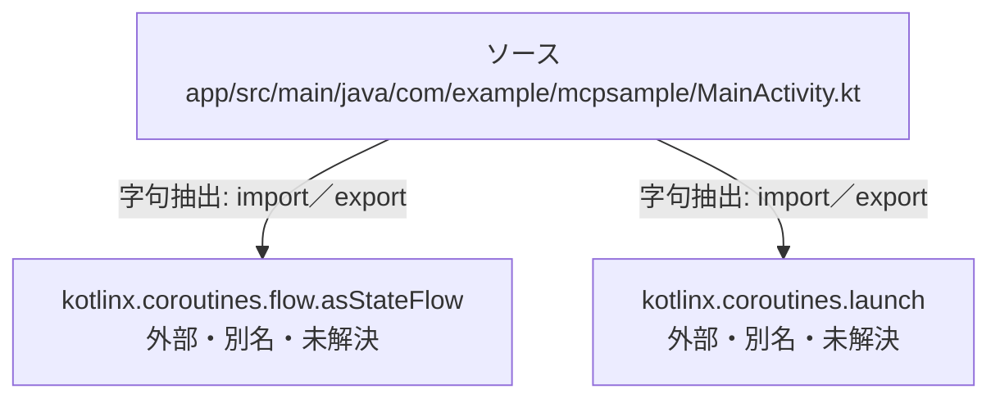

# dependency-map/n-app-src-main-java-com-example-mcpsample-mainactivity-kt-8500b4/imports-4

[解析トップへ戻る](../../../README.md)

import参照の表示用グループ。

## 要素の説明

### n-kotlinx-coroutines-flow-asstateflow-5dc6a6

参照名: `kotlinx.coroutines.flow.asStateFlow`

ローカルのソース対応先を確定できませんでした。外部ライブラリ、標準ライブラリ、型別名などを区別する追加確認が必要です。

### n-kotlinx-coroutines-launch-a65dcb

参照名: `kotlinx.coroutines.launch`

ローカルのソース対応先を確定できませんでした。外部ライブラリ、標準ライブラリ、型別名などを区別する追加確認が必要です。

### source

`app/src/main/java/com/example/mcpsample/MainActivity.kt` の内容を確認しました。

