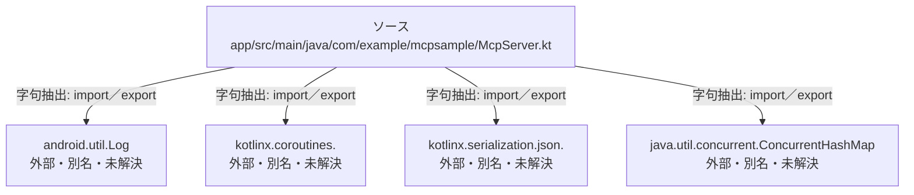

# dependency-map/n-app-src-main-java-com-example-mcpsample-mcpserver-kt-b8760f

[解析トップへ戻る](../../README.md)

確認済みファイル: `app/src/main/java/com/example/mcpsample/McpServer.kt`

解析: 字句抽出。静的なimport／export参照です。関数の実行順序やHTTP通信は表していません。

宣言: `McpServer`

- `android.util.Log` → 外部・標準ライブラリ・別名など。ローカル対応先は未確定
- `kotlinx.coroutines.` → 外部・標準ライブラリ・別名など。ローカル対応先は未確定
- `kotlinx.serialization.json.` → 外部・標準ライブラリ・別名など。ローカル対応先は未確定
- `java.util.concurrent.ConcurrentHashMap` → 外部・標準ライブラリ・別名など。ローカル対応先は未確定

## 要素の説明

### n-android-util-log-01ae4d

参照名: `android.util.Log`

ローカルのソース対応先を確定できませんでした。外部ライブラリ、標準ライブラリ、型別名などを区別する追加確認が必要です。

### n-java-util-concurrent-concurrenthashmap-aaf1d9

参照名: `java.util.concurrent.ConcurrentHashMap`

ローカルのソース対応先を確定できませんでした。外部ライブラリ、標準ライブラリ、型別名などを区別する追加確認が必要です。

### n-kotlinx-coroutines-3f2bab

参照名: `kotlinx.coroutines.`

ローカルのソース対応先を確定できませんでした。外部ライブラリ、標準ライブラリ、型別名などを区別する追加確認が必要です。

### n-kotlinx-serialization-json-74d782

参照名: `kotlinx.serialization.json.`

ローカルのソース対応先を確定できませんでした。外部ライブラリ、標準ライブラリ、型別名などを区別する追加確認が必要です。

### source

`app/src/main/java/com/example/mcpsample/McpServer.kt` の内容を確認しました。

