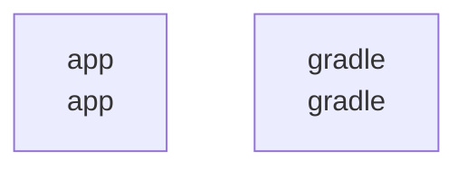

# overall-architecture

[解析トップへ戻る](../README.md)

# KotlinMCPSample

AndroidのAI Function CallingとMCPのサンプル。MainActivity、McpServer、Gradle構成を確認しました。

この図はリポジトリ内の構成です。コードを実行した結果やサービス間の通信保証ではありません。

## 対象と根拠

対象: https://github.com/FORIFOR/KotlinMCPSample

取得ブランチ: `main`

Git tree SHA: `82a009222e108b9829d437047ee23ac448a402d8`

ファイル一覧: 48件。内容確認: 5件。全ファイルの意味解析ではありません。

## 解析の制約

実コードの取得は入口、マニフェスト、直接参照先を中心とする初回解析です。動的ロード、実行時設定、別リポジトリとの接続、ローカル未コミット変更は未確認です。

## 確認が必要な点

構成図の配置関係と、実際の通信・呼び出し関係を区別してください。README上の機能や精度の記述は動作検証済みという意味ではありません。

## 追加解析

未読の中核モジュールから処理順序・データ保存・状態遷移を追加解析する。実行環境で通信先と機能フラグを照合する。

## 補足

2026-10-11の初回解析スナップショットです。現在のコードとの差分や実行環境は追加確認が必要です。

## 要素の説明

### n-app-7d1043

確認したパス: `app`。配下の登録ファイルは32件。

- `app/build.gradle.kts`（内容確認済み）
- `app/proguard-rules.pro`（一覧のみ）
- `app/src/main/AndroidManifest.xml`（一覧のみ）
- `app/src/main/java/com/example/mcpsample/AIService.kt`（一覧のみ）
- `app/src/main/java/com/example/mcpsample/GeminiClient.kt`（一覧のみ）
- `app/src/main/java/com/example/mcpsample/GeminiClientWithFunctions.kt`（一覧のみ）
- `app/src/main/java/com/example/mcpsample/GeminiModels.kt`（一覧のみ）
- `app/src/main/java/com/example/mcpsample/MainActivity.kt`（内容確認済み）
- `app/src/main/java/com/example/mcpsample/MainActivity.kt.broken`（一覧のみ）
- `app/src/main/java/com/example/mcpsample/McpClient.kt`（一覧のみ）
- `app/src/main/java/com/example/mcpsample/McpClientManager.kt`（一覧のみ）
- `app/src/main/java/com/example/mcpsample/McpModels.kt`（一覧のみ）
- `app/src/main/java/com/example/mcpsample/McpServer.kt`（内容確認済み）
- `app/src/main/java/com/example/mcpsample/McpServerConfig.kt`（一覧のみ）
- `app/src/main/java/com/example/mcpsample/McpServerManager.kt`（一覧のみ）
- `app/src/main/java/com/example/mcpsample/McpTransport.kt`（一覧のみ）
- `app/src/main/java/com/example/mcpsample/OpenAIClient.kt`（一覧のみ）
- `app/src/main/java/com/example/mcpsample/OpenAIModels.kt`（一覧のみ）
- `app/src/main/java/com/example/mcpsample/OpenAIService.kt.backup`（一覧のみ）
- `app/src/main/java/com/example/mcpsample/UiState.kt`（一覧のみ）
- `app/src/main/java/com/example/mcpsample/tools/FunctionRegistry.kt`（一覧のみ）
- `app/src/main/java/com/example/mcpsample/tools/ToolServices.kt`（一覧のみ）
- `app/src/main/res/drawable/ic_launcher_background.xml`（一覧のみ）
- `app/src/main/res/drawable/ic_launcher_foreground.xml`（一覧のみ）
- `app/src/main/res/mipmap-anydpi-v26/ic_launcher.xml`（一覧のみ）
- `app/src/main/res/mipmap-anydpi-v26/ic_launcher_round.xml`（一覧のみ）
- `app/src/main/res/values-night/themes.xml`（一覧のみ）
- `app/src/main/res/values/colors.xml`（一覧のみ）
- `app/src/main/res/values/strings.xml`（一覧のみ）
- `app/src/main/res/values/themes.xml`（一覧のみ）
- `app/src/main/res/xml/backup_rules.xml`（一覧のみ）
- `app/src/main/res/xml/data_extraction_rules.xml`（一覧のみ）

### n-gradle-a836fa

確認したパス: `gradle`。配下の登録ファイルは1件。

- `gradle/wrapper/gradle-wrapper.properties`（一覧のみ）

